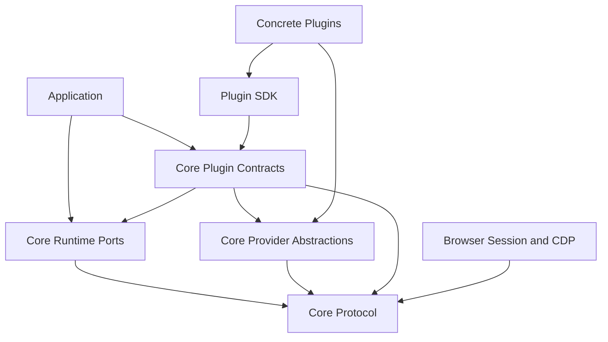

# BCA 架构

BCA 将浏览器信息采集、页面业务解析和用户交互分离。Core 管理浏览器能力和运行机制；插件定义页面状态、展示方式与命令映射；Application 负责配置、CLI 和诊断。

## 目录与职责

| 路径 | 职责及当前状态 |
| --- | --- |
| `src/bca/core/protocol` | 标准库冻结 dataclass、字段校验、显式 codec；包 0.2.0 / 协议 2 |
| `src/bca/core/errors.py` | 已实现统一操作异常层次 |
| `src/bca/core/providers` | 已实现 Provider 抽象、能力注册与查询 |
| `src/bca/core/runtime` | 已定义状态和事件提交端口，调度器待实现 |
| `src/bca/core/plugins` | 已定义插件元信息、配置、上下文和接口 |
| `src/bca/core/browser` | CDP 会话、显式元数据刷新、PNG Capture 与 Input Provider；共享只读视口几何测量 |
| `src/bca/plugin_sdk/interfaces` | 复用 Core 插件接口，不创建另一套协议 |
| `src/bca/plugin_sdk/assets`、`vision` | 预留资源和识别辅助功能 |
| `src/bca/app`、`app/cli` | 显式日志配置函数；CLI 和配置加载待实现 |
| `plugins/example` | 可运行于模拟 Provider 的最小插件 |
| `plugins/majsoul` | 业务插件预留目录 |
| `tests/core`、`plugin_sdk`、`app` | 协议、Provider、插件集成与工程测试 |
| `configs/default.toml` | 配置格式示例，尚未接入应用启动 |
| `docs/md` | 原始需求，保留不修改 |

## 依赖方向

Protocol 只依赖标准库及无其他依赖的 `core.errors`。Core 不导入 SDK、Application 或具体插件。SDK 公开复用 Core 契约；插件发现、加载和运行编排由未来 Core 管理器负责。ProviderLookup、StateSink、EventSink 为可注入的 Protocol，PluginContext 不绑定 Registry 或队列实现。

## 执行与所有权

采用单个 asyncio 事件循环；有 I/O 的 Provider 和插件方法均异步。注册与查询为无 I/O 同步操作。注册器不自动启动或释放 Provider，Core 持有所有权。同步 CPU 密集识别应由后续 SDK 移到线程/进程，避免堵塞事件循环。

正常调用链：Application 读取命令 → 插件解析 Command → 插件返回有序 Action 元组 → Core 逐个 await InputProvider → Application 展示 ActionResult。观察链：Core 调用插件 observe → 插件选择 Provider → 返回 PageState → Core await StateSink.publish → Application 展示插件格式化结果。

Frame 持有编码后的 PNG/JPEG 不可变 bytes，进程内传递同一对象，不复制图像缓冲。codec 默认仅输出帧元数据，完整 Base64 输出需显式开启。模型外壳冻结；嵌套 JSON 容器按引用持有，提交后不得修改，调用方若需要独立状态应在构造前复制。Core 不解释插件 data 的业务含义。

当前唯一标准状态路径是 Runtime 拉取 `observe()` 返回值并 await `context.states.publish(state)`；插件不得在 observe 中再发布相同状态。未来自有推送任务模式需在 BCA-02/03 明确调度协议后扩展。

总体技术方向依据 `docs/md/BCA_PROJECT_CONTEXT.md`：Windows 优先、Chromium/Edge + CDP 优先、视觉优先的雀魂首个插件。目前已实现 CDP 会话及 PNG 采集；业务插件和视觉识别仍属后续阶段。

Browser 已提供按需截图和输入能力，具体实现依赖 Provider 抽象及 Protocol 2；ProviderRegistry 不负责其启动或关闭。01.4 使用现有对象组合，无新增 Browser 状态机或跨 Provider 全局锁。examples/browser_end_to_end.py 提供显式连接/绑定、注册、截图识别、输入、DOM 核验和有序清理的完整示例。观察上下文由调用方维护，不修改 Frame 协议。

事件总线、周期调度和自动恢复仍待后续阶段。01.4 本轮全量 285 passed（含 01.1～01.4 的真实 Edge 入口），正式接入契约见 [BCA-01_MAIN_SYNC.md](BCA-01_MAIN_SYNC.md)。开发完成、待阶段审查，不代表 BCA-02 或业务插件已实现。
